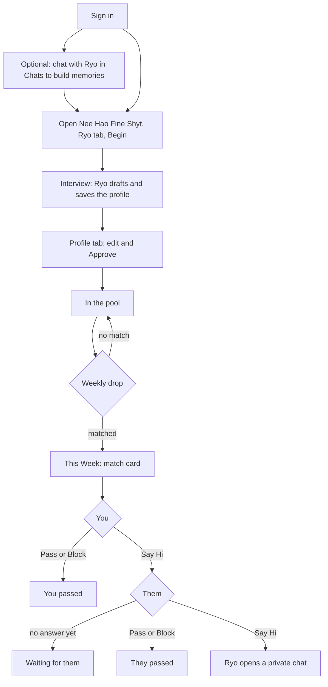

# Nee Hao Fine Shyt

> **Changing:** Nee Hao Fine Shyt is becoming a dating app built to get people on real dates. Weekly matching is retired, and onboarding now collects dating basics and photos. See `docs/proposals/dating-flow.md`. The rest of this page describes the original weekly friend/collaborator flow and will be rewritten once date plans ship.

Nee Hao Fine Shyt introduces you to one person a week who you should meet as a friend or collaborator (not dating). Ryo interviews you, drafts a short profile, and once you approve it, pairs you with someone each week. If you both say hi, Ryo opens a private chat for the two of you.

This page is the full user flow: the happy path step by step, every other state a user can land in, the privacy rules, and how operators run the weekly drop.

## Flow at a glance

Every ending (chat opened, passed, blocked, unanswered) goes back to the pool for next week's drop.

## The app

Nee Hao Fine Shyt has a sidebar with three panes, plus a list of past matches:

| Pane | What it shows |
|------|---------------|
| **Ryo** | The interview chat. Same bubbles, input, voice, and speak button as Chats. |
| **This Week** | Your current match card, or your pool status. Opens by default. |
| **Profile** | Your profile text, its tags, and the Approve / Pause / Resume / Leave buttons. |
| **Matches** | One entry per past match whose chat room was opened. Clicking opens the room in Chats. |

**File ▸ Refresh** reloads your profile and match. The app does this automatically when the window opens and after each interview reply.

## Happy path

The screenshots follow a test user, @lena, through every step.

### 1. Sign in

Nee Hao Fine Shyt needs an account. Signed-out users see **"Sign in to use Nee Hao Fine Shyt"** and nothing else. Accounts are created in Chats.

### 2. Let Ryo get to know you (optional)

Anything you tell Ryo in Chats can become a long-term memory, either through the **Memory Write** tool during the chat or through extraction when you clear the chat. Nee Hao Fine Shyt uses these memories to pre-fill your first draft, so a user who has talked to Ryo skips most of the interview.

You can skip this step. Without memories, Ryo just asks the questions from scratch.

### 3. Start the interview

Open Nee Hao Fine Shyt. First-time users see **This Week** with *"Once a week, Ryo introduces you to one person you should meet — a friend or collaborator."* and a **Get Started** button, which switches to the **Ryo** pane.

The Ryo pane explains *"Ryo will ask a few questions and draft your profile. You'll review it before anything is shared."* and offers two ways in:

- **Call Ryo:** a hands-free voice call, like phoning a friend. See [Voice call](#voice-call).
- **Begin:** the same interview by text.

Either way, the app sends *"hi ryo, help me set up my match profile"* so Ryo opens the conversation.

### 4. The interview

Ryo asks one question at a time, in your language:

- **With memories:** Ryo drafts a profile right away from what it remembers, shows it, and asks *"what feels off or missing?"*
- **Without memories:** Ryo asks what you're building or into lately, what you'd love help with or can help others with, and who you'd like to meet.

After every meaningful answer Ryo saves the full updated draft. A status row, **"Profile draft updated — check Profile"**, appears on its reply. When the draft feels complete, Ryo tells you to review it in the Profile tab and press Approve.

#### Voice call

On a call, Ryo speaks every reply in its own voice, and the mic opens by itself as soon as Ryo stops talking. You just talk. When you go quiet for about a second, what you said is transcribed, appears as your chat bubble, and goes to Ryo. A bar at the bottom replaces the text box and shows where the call is:

| Bar shows | Meaning |
|-----------|---------|
| 🔴 **Listening…** | Mic is open; talk now |
| **Ryo is thinking…** | Your words are being transcribed, or Ryo is writing a reply |
| **Ryo is talking… tap to cut in** | Ryo is speaking; tap the bar to stop it and answer right away |
| **Connecting…** | The short pause between turns |

- **Hang Up** ends the call and releases the mic. Closing the window does the same.
- **Switching modes:** you can switch between talking and typing any time. With the call off, a **Call Ryo** button sits next to the text box and picks up where the conversation left off.
- **On calls, Ryo keeps replies short and speakable:** no lists or formatting, but it will still read your draft aloud.
- **Errors end the call:** if the mic is blocked or transcription fails, the call ends and the error shows above the pane.

**What Ryo puts in a profile:** 2–5 first-person sentences, up to 600 characters, concrete (projects, tools, hobbies, cities). It never includes health, relationships, finances, exact location, contact info, or anything you mark private, even if Ryo remembers it. It never invents facts.

### 5. Review and approve

The **Profile** pane shows *"This is what your match sees. Nothing is shared until you approve."* above an editable text box holding Ryo's latest draft. You can rewrite any of it. Your unsaved edits are kept even when Ryo saves a newer draft in the background.

Press **Approve** (enabled at 20+ characters). Ryo filters profanity, extracts 3–12 matching tags (shown under the text, e.g. `sound-design · synths · taipei`), and adds you to the pool. The button changes to **Approved ✓**.

### 6. Wait for the drop

**This Week** now says *"You're in the pool. Your next match drops this week."* Nothing else happens until the weekly drop runs (see [Operators](#operators-the-weekly-drop)).

### 7. Get matched

After the drop, **This Week** shows a match card:

- **Meet @username** and their approved profile, exactly as they approved it
- **Why you two:** one or two sentences addressed to both of you
- **Icebreaker:** a first message written in your voice, referencing their profile
- Buttons: **Say Hi**, **Pass**, **Block**

Each side sees their own icebreaker. The "why" is the same on both cards.

### 8. Say hi

Press **Say Hi**. If the other person hasn't answered yet, the card shows *"You said yes. Waiting for them…"*

### 9. Both said hi: open the chat

When both people have said hi, Ryo creates a private room for the two of you (named `@you, @them`) and posts *"matched you two this week 🤝"* followed by the "why". The card's buttons change to **Open Chat**, and the room also appears under **Matches** in the sidebar and in Chats.

From here it's a normal Chats room. Next week you're eligible for a new match.

## Every other state

### Match outcomes

What each side sees on **This Week**, depending on both answers:

| You | Them | You see |
|-----|------|---------|
| No answer yet | Any | The card with Say Hi / Pass / Block. Their answer stays hidden until you respond. |
| Say Hi | No answer yet | *"You said yes. Waiting for them…"* |
| Say Hi | Say Hi | **Open Chat** |
| Say Hi | Pass or Block | *"They passed this time. New match next week."* |
| Pass | Any | *"You passed on this one."* |
| Block | Any | *"You passed on this one."* |

**Block vs Pass:** to the other person, a block looks exactly like a pass. The difference is that a block is permanent: the two of you are never paired again, whichever of you blocked. In practice, every past pairing (accepted, passed, or ignored) is also never repeated, so a block mainly matters if that rule ever changes.

**Nobody answers:** the card stays up until the next weekly drop replaces it with a new match, or for up to 14 days if no new match comes.

### No match this week

The drop can skip you when:
- fewer than two people are eligible, or there's an odd number and you're left over
- the AI judge scored every candidate under 60/100
- everyone else in the pool has already been paired with you or blocked you

You keep seeing *"You're in the pool. Your next match drops this week."* and the next week's drop tries again.

### Pause and resume

**Profile ▸ Pause** takes you out of the pool. **This Week** says *"Matches are paused. Resume from the Profile tab."* and **Resume** puts you back. A match card you already have stays visible while paused, and you can still answer it.

### Edit an approved profile

Edit the text and press **Approve** again. Ryo re-extracts tags, and future matches see the new text. A match card already delivered keeps the version the other person was shown. Editing while paused keeps you paused, because editing isn't treated as opting back in.

You can also go back to the **Ryo** pane and ask for changes. Ryo sees both your current draft and your approved profile.

### Leave Nee Hao Fine Shyt

**Profile ▸ Leave Nee Hao Fine Shyt** deletes your profile and draft, and removes your current match from **both** sides, so the other person's card disappears too. A chat room that was already opened stays. Your blocks and pairing history are kept, so re-joining later won't re-pair you with people you blocked or met.

### Delete your account

Deleting your ryOS account removes all Nee Hao Fine Shyt data, including blocks and history, and dissolves any current match.

### Errors and limits

| Situation | What the user sees |
|-----------|--------------------|
| Profile under 20 characters | Approve is disabled |
| Tag extraction fails on approve | *"Could not process profile, try again"* |
| Interview: more than 10 messages a minute or 60 a day | The chat shows an error with a retry |
| Approve: more than 5 a minute or 30 a day | Rate-limit error above the pane |
| Closing the window mid-interview | The transcript is gone, but every saved draft is kept in Profile |
| Mic permission denied, or transcription fails, during a call | The call ends and the error shows above the pane |
| Mutual accept but room creation failed | Opening **This Week** retries the room automatically |

## Privacy rules

- **Matching reads only your approved profile text and its tags.** It never reads your memories, chats, or drafts.
- **Nothing is shared until you approve.** Ryo may use memories to *suggest* draft text, but you see and approve every word.
- **Sensitive details stay out.** Ryo is instructed never to include health, relationships, finances, exact location, or contact info.
- **Rejections are private.** The other person can't tell a pass from a block, and doesn't see your answer until they've given theirs.
- **Chat only after both say hi.** No room, no direct contact before mutual acceptance.

## Operators: the weekly drop

The drop is a scheduled call to `GET /api/cron/matchmaker-drop` with `Authorization: Bearer ${CRON_SECRET}`. The schedule lives in your external scheduler (e.g. a Coolify scheduled task), set to once a week. The app copy says matches drop "this week", so any weekday works.

Each run:
1. **Eligible users:** everyone in the pool with an active, approved profile who hasn't had a match in the last 6 days. This makes retries safe: a rerun only fills in the people who were missed.
2. **Shortlist:** for each user, the top 5 candidates by tag overlap, excluding anyone already paired with or blocked by either side. Candidates with zero overlap still count, because small pools need them.
3. **Judge:** one AI call per candidate pair scores it 0–100 and writes the "why" and both icebreakers. Capped at 300 calls per run, spread evenly so nobody's #1 candidate is skipped.
4. **Pair:** best scores first, each user matched at most once, minimum score 60.
5. **Deliver:** writes each side's card and records the pairing so it never repeats.

The response reports `poolSize`, `eligible`, `judged`, `unjudged`, `matched`, and `judgeErrors`. Status codes: `409` if a previous run is still going (only one runs at a time), `503` if `CRON_SECRET` isn't set, `401` for a bad token.

All AI steps (interview, tags, judge) run on `gpt-6-luna`.

### Data

All keys live under `agent:matchmaker:` in Redis (see `src/shared/redisKeys.ts`):

| Key | Holds | Lifetime |
|-----|-------|----------|
| `user:{u}:profile` | Approved text, tags, status (`none` / `active` / `paused`) | Until leave or account deletion |
| `user:{u}:draft` | Latest interview draft | Until leave or account deletion |
| `user:{u}:drop` | This week's card (partner, their profile, score, why, icebreaker) | 14 days |
| `user:{u}:seen` | Everyone you've been paired with | Until account deletion |
| `user:{u}:blocked` | Everyone you've blocked | Until account deletion |
| `pool` | Usernames with an active approved profile | — |
| `pair:{a}:{b}:{createdAt}` | Both answers and the room id | 14 days |

## Known gaps

- **No notification when a match drops.** Users only find out by opening Nee Hao Fine Shyt. Push, email, and Telegram all exist in ryOS and could carry it.
- **"No match this week" looks the same as "waiting".** A skipped user keeps seeing *"Your next match drops this week."*
- **No re-join prompt after a skip or pass.** The user has to come back on their own.
- **The interview transcript isn't saved.** Only the draft survives a closed window.
- **Voice calls take turns.** You can't talk over Ryo; you tap to cut in instead. Each turn waits for transcription, the reply, and speech, so expect a pause of a couple of seconds. A realtime speech-to-speech session would fix both, at the cost of Ryo's custom voice.

## Technical details

The app was renamed from Matchmaker to Nee Hao Fine Shyt. Only the display name changed: the app id, file paths, API routes, and Redis keys still use `matchmaker`, so existing profiles and matches carry over.

| Piece | File |
|-------|------|
| App UI (sidebar, panes) | `src/apps/matchmaker/components/MatchmakerAppComponent.tsx` |
| Client API | `src/api/matchmaker.ts` |
| Interview (`POST`) | `api/matchmaker/chat.ts` (`matchmakerIntake` agent, `saveMatchProfileDraft` tool) |
| Profile (`GET` / `PUT` approve, pause, resume / `DELETE` leave) | `api/matchmaker/profile.ts` |
| Match card (`GET` / `POST` accept, decline, block) | `api/matchmaker/drop.ts` |
| Weekly drop | `api/cron/matchmaker-drop.ts` |
| Matching, storage, room creation | `api/matchmaker/_lib.ts` |
| Interview and judge prompts | `api/_utils/_aiPrompts.ts` (`MATCHMAKER_INTAKE_INSTRUCTIONS`, `MATCHMAKER_JUDGE_INSTRUCTIONS`) |
| Tests | `tests/unit/matchmaker/` |

**Window:** 640 × 520 px default, 480 × 400 px minimum. Localized in 11 languages. The interview reuses Chats' message list, input, and speech.

## Related apps

- **[Chats](/docs/chats):** account sign-in, the memories that pre-fill your profile, and the rooms where matches talk.
